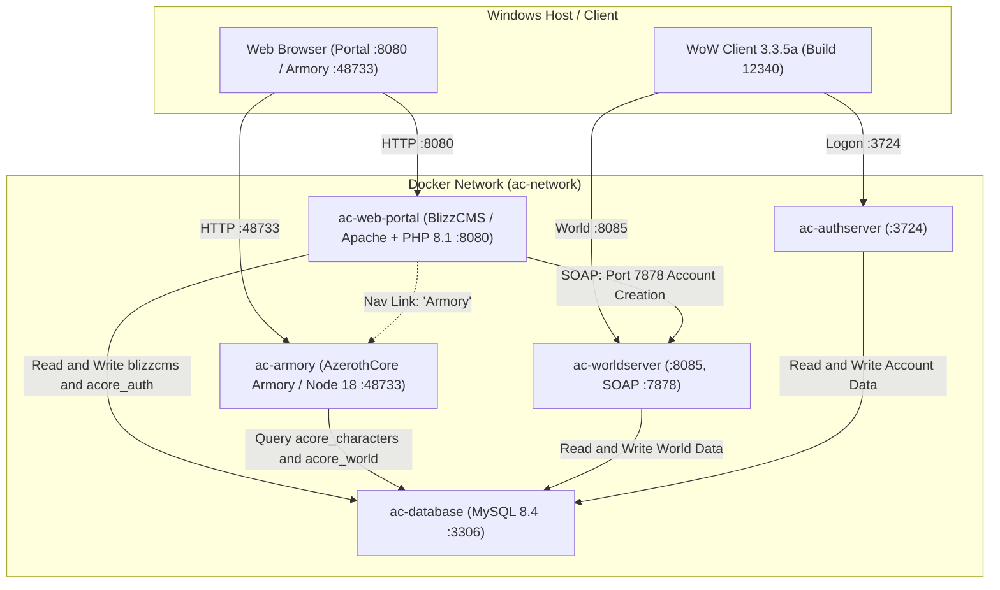

# Web Portal & Armory Guide: BlizzCMS + AzerothCore Armory

This guide documents the turn-key web stack configured for the **AzerothCore Docker Solo Lab**:
* **BlizzCMS (`http://localhost:8080`)**: Account sign-up/registration portal, realm uptime monitor, news, and player account dashboard.
* **AzerothCore Armory (`http://localhost:48733`)**: Full interactive character inspection with gear paperdoll, item tooltips, talent tree builds, achievements, and guild rosters.

---

## Architecture Overview



---

## 1. Engine Configuration (`worldserver.conf`)

BlizzCMS communicates with the running worldserver via **SOAP (Simple Object Access Protocol)** to securely execute `account create` commands with proper SRP6 cryptographic hashing.

In `env/dist/etc/worldserver.conf`:
```ini
SOAP.Enabled = 1
SOAP.IP = "0.0.0.0"
SOAP.Port = 7878
```

Your game admin account (`ADMIN`) must have GM level 3 to authorize SOAP commands:
```text
account set gmlevel ADMIN 3 -1
```

---

## 2. Docker Compose Override

The services are declared in `docker-compose.override.yml` in your `~/azerothcore-wotlk` directory:

```yaml
services:
  ac-web-portal:
    build:
      context: ./blizzcms
      dockerfile: ./docker/server/Dockerfile
      args:
        USER_ID: 1000
        GROUP_ID: 1000
    container_name: ac-web-portal
    restart: unless-stopped
    ports:
      - '8080:80'
    working_dir: /var/www/html
    volumes:
      - ./blizzcms:/var/www/html
      - ./blizzcms/docker/server/apache/sites-enabled:/etc/apache2/sites-enabled
      - ./blizzcms/docker/server/php/php.ini:/usr/local/etc/php/conf.d/extra-php-config.ini
    networks:
      - ac-network
    depends_on:
      ac-database:
        condition: service_healthy

  ac-armory:
    build:
      context: ./armory
      dockerfile: Dockerfile
    container_name: ac-armory
    restart: unless-stopped
    ports:
      - '48733:48733'
    env_file:
      - ./armory/.env
    networks:
      - ac-network
    depends_on:
      ac-database:
        condition: service_healthy
```

---

## 3. Armory Configuration (`armory/.env`)

The `ac-armory` container is configured via `./armory/.env`:

```env
ACORE_ARMORY_AOWOW_URL="https://wowgaming.altervista.org/aowow"
ACORE_ARMORY_WEBSITE_URL="http://localhost:48733"
ACORE_ARMORY_WEBSITE_NAME="AzerothCore Solo Lab"
ACORE_ARMORY_WEBSITE_ROOT=""
ACORE_ARMORY_IFRAME_MODE__ENABLED=0
ACORE_ARMORY_IFRAME_MODE__URL=""
ACORE_ARMORY_LOAD_DBCS=1
ACORE_ARMORY_HIDE_GAME_MASTERS=0
ACORE_ARMORY_TRANSMOG_MODULE=0
ACORE_ARMORY_USE_ZAM_CDN=1
ACORE_ARMORY_REALMS__0__NAME="AzerothCore"
ACORE_ARMORY_REALMS__0__REALM_ID=1
ACORE_ARMORY_REALMS__0__AUTH_DATABASE="acore_auth"
ACORE_ARMORY_REALMS__0__CHARACTERS_DATABASE__HOST="ac-database"
ACORE_ARMORY_REALMS__0__CHARACTERS_DATABASE__PORT=3306
ACORE_ARMORY_REALMS__0__CHARACTERS_DATABASE__USER="root"
ACORE_ARMORY_REALMS__0__CHARACTERS_DATABASE__PASSWORD="password"
ACORE_ARMORY_REALMS__0__CHARACTERS_DATABASE__DATABASE="acore_characters"
ACORE_ARMORY_WORLD_DATABASE__HOST="ac-database"
ACORE_ARMORY_WORLD_DATABASE__PORT=3306
ACORE_ARMORY_WORLD_DATABASE__USER="root"
ACORE_ARMORY_WORLD_DATABASE__PASSWORD="password"
ACORE_ARMORY_WORLD_DATABASE__DATABASE="acore_world"
ACORE_ARMORY_DB_QUERY_TIMEOUT=10000
```

> [!NOTE]
> **Graceful Metadata Fallback Patch**: Upstream Zamimg CDN endpoints for `meta/charactercustomization2` were deprecated by Wowhead. `src/armory/data/CharacterCustomization.ts` and `src/armory/controllers/CharacterController.ts` are patched with graceful `try/catch` fallbacks to allow the entire Armory suite (gear paperdoll, talent trees, achievements, stats, and guilds) to operate reliably without crashing on startup.

---

## 4. BlizzCMS Setup & Linking

### A. Dedicated Database
The CMS database (`blizzcms`) runs directly inside the `ac-database` MySQL 8.4 container:
```sql
CREATE DATABASE IF NOT EXISTS blizzcms CHARACTER SET utf8mb4 COLLATE utf8mb4_unicode_ci;
GRANT ALL PRIVILEGES ON blizzcms.* TO 'root'@'%';
FLUSH PRIVILEGES;
```

### B. Realm Linking (`/admin/realms/add`)
To connect the live game realm to BlizzCMS:
* **Realm Name:** `AzerothCore`
* **Characters Host:** `ac-database` (port `3306`, db `acore_characters`, user `root`, pass `password`)
* **SOAP Host:** `ac-worldserver` (port `7878`, user `ADMIN`, pass `<admin_pass>`)
* **Status Host:** `ac-worldserver` (port `8085`)

### C. Armory Navigation Link
The "Armory" link in the top navigation bar is registered in `blizzcms.menus_items`:
```sql
INSERT INTO blizzcms.menus_items (menu_id, name, url, icon, target, type, parent, sort)
VALUES (1, 'Armory', 'http://localhost:48733', 'fa-solid fa-shield-halved', '_self', 'link', 0, 2);
```
With its view permission granted to all roles in `blizzcms.permissions` and `blizzcms.roles_permissions`.

---

## 5. Daily Operations & User Workflow

1. **Player Registration**:
   * Visit `http://localhost:8080/register`.
   * The account is instantly provisioned in `acore_auth` with valid SRP6 hashes.
2. **Character Creation**:
   * Player launches the 3.3.5a game client (`realmlist 127.0.0.1`), logs in, and customizes their character in-game.
3. **Armory Inspection**:
   * Visit `http://localhost:48733` or click **Armory** in the website header.
   * Search for any character or guild to inspect gear, stats, and talent trees.
4. **Automated Backups**:
   * `scripts/backup.sh` automatically includes the `blizzcms` database and configuration archives in its hot backup routine.
